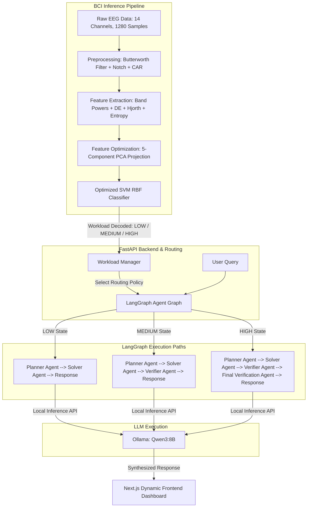

# Cognitive-State-Aware Adaptive Multi-Agent BCI System

[](https://opensource.org/licenses/MIT)
[](https://www.python.org/)
[](https://fastapi.tiangolo.com/)
[](https://nextjs.org/)
[](https://langchain-ai.github.io/langgraph/)

An open-source, research-grade Brain-Computer Interface (BCI) system that decodes user cognitive workload in real-time from EEG telemetry and dynamically personalizes the downstream Large Language Model (LLM) agent collaboration topology. By bridging user neurophysiology with stateful agent graphs, this project optimizes human-agent interaction ergonomics.

---

## 🚀 System Architecture Overview

The system is designed with a five-layer closed-loop architecture:



---

## 🧠 Cognitive-State-Aware Adaptive Policies

The agent collaboration topology dynamically scales based on the user's workload state to balance reasoning depth, confidence validation, and information formatting constraints:

| Workload Level | Active Agents | Verifier Loops | Conf. Threshold | Detail Level (Constraints) |
| :--- | :--- | :--- | :--- | :--- |
| **LOW** | Planner, Solver | 0 (Bypassed) | 70% | Verbose detailed explanation with examples |
| **MEDIUM** | Planner, Solver, Verifier | 1 | 80% | Balanced explanation |
| **HIGH** | Planner, Solver, Verifier, Final Verification | 2 | 95% | Bullet points only (Cognitive relief format) |

### Agent Description:
1. **Planner Agent**: Analyzes the question and generates a step-by-step conceptual plan.
2. **Solver Agent (Research)**: Drafts a detailed response guiding off the plan.
3. **Verifier Agent**: Checks the solution against confidence thresholds, providing iterative correction feedback.
4. **Final Verification Agent**: Performs final rigorous safety, logical coherence, and formatting checks before delivery.

---

## 🛠️ Technology Stack

- **Frontend**: [Next.js](https://nextjs.org/) (TypeScript, React 19) + [Tailwind CSS](https://tailwindcss.com/)
- **Backend API**: [FastAPI](https://fastapi.tiangolo.com/) (Python 3.11-3.13)
- **Agentic Flow**: [LangGraph](https://langchain-ai.github.io/langgraph/) (Stateful cyclic orchestration)
- **Local Inference**: [Ollama](https://ollama.com/) executing `qwen3:8b` locally
- **BCI Classifier**: [scikit-learn](https://scikit-learn.org/) (Support Vector Machine with RBF Kernel + PCA feature optimization)
- **Signal Processing**: [scipy](https://scipy.org/) (Butterworth bandpass, notch filters, Welch periodogram)

---

## 📁 Repository Structure

```text
├── backend/
│   ├── app/
│   │   ├── core/              # Core modules: LLM setup, predictor, agent flow
│   │   ├── config.py          # Settings and environment variables loading
│   │   ├── main.py            # FastAPI main application server
│   │   └── schemas.py         # Request and Response Pydantic schemas
│   ├── tests/                 # Unit and integration test suites
│   ├── Dockerfile
│   └── requirements.txt
├── frontend/
│   ├── src/                   # React/Next.js dashboard code
│   ├── package.json
│   ├── tsconfig.json
│   └── Dockerfile
├── workload_classifier/
│   ├── analysis/              # Data analysis and visual verification scripts
│   ├── data/stew/             # Extracted models, configuration, and raw MAT caches
│   ├── preprocessing/         # Filter definitions and pipeline modules
│   ├── utils/data_loader.py   # EEG data mapping utilities
│   ├── classifier.py          # ML classifier training and model grid
│   └── extractor.py           # Band power, Hjorth, and differential entropy extraction
├── reports/                   # Academic internship evaluation reports
├── docker-compose.yml
├── .env.example
├── .gitignore
├── README.md
└── SETUP.md
```

---

## ⚙️ Configuration & Environment Variables

Create a `.env` file in the project root. See [.env.example](file:///d:/Document/bci/.env.example) for documentation.

```ini
# LLM Configuration (Ollama)
OLLAMA_HOST=http://localhost:11434
OLLAMA_MODEL=qwen3:8b
OLLAMA_NUM_GPU=-1

# API Configuration
HOST=0.0.0.0
PORT=8000
```

---

## ⚡ Quick Start

For detailed step-by-step setup (including Python/Node setup and dataset training), refer to the [SETUP.md](file:///d:/Document/bci/SETUP.md).

### Prerequisites
- Python 3.11, 3.12, or 3.13
- Node.js v18.0.0 or higher
- Ollama running locally with `qwen3:8b` pulled (`ollama pull qwen3:8b`)

### Option A: Running Locally

1. **Start Backend**:
   ```bash
   cd backend
   python -m venv venv
   source venv/bin/activate  # .\venv\Scripts\Activate.ps1 on Windows
   pip install -r requirements.txt
   uvicorn app.main:app --reload --port 8000
   ```

2. **Start Frontend**:
   ```bash
   cd frontend
   npm install
   npm run dev
   ```

3. Open your browser to `http://localhost:3000`.

### Option B: Running with Docker Compose
```bash
docker-compose up --build
```

---

## 🔌 REST API Overview

### 1. Workload Prediction
- **Endpoint**: `POST /predict-workload`
- **Payload**:
  ```json
  {
    "eeg_data": [[0.1, 0.2, ...], ...],  // 14 channels x 1280 samples
    "simulate": true,                     // Load segment from STEW raw cache
    "target_class": 0                    // Optional: 0 (Low), 1 (Medium), 2 (High)
  }
  ```
- **Response**:
  ```json
  {
    "workload": "HIGH",
    "confidence": 0.88,
    "processing_time_ms": 14.8,
    "ground_truth_class": 2
  }
  ```

### 2. Adaptive Chat
- **Endpoint**: `POST /chat`
- **Payload**:
  ```json
  {
    "question": "Explain quantum entanglement.",
    "workload": "LOW",
    "eeg_data": null,
    "dev_mode": false
  }
  ```
- **Response**:
  ```json
  {
    "answer": "Quantum entanglement is a physical phenomenon...",
    "metadata": {
      "workload": "HIGH",
      "dev_mode": false,
      "predicted_workload": "HIGH",
      "prediction_confidence": 0.88,
      "prediction_time_ms": 14.8,
      "agents_used": 4,
      "verification_loops": 2,
      "confidence_threshold": 95,
      "visited_nodes": ["Planner Agent", "Research Agent", "Verifier Agent", "Final Verification Agent"]
    }
  }
  ```

---

## 🖥️ Screen Mockups (Placeholder)

> [!NOTE]
> Add screenshots or screen recording GIFs of the Next.js visual execution path dashboard and active EEG prediction graphs here.

---

## ⚠️ Known Limitations & Future Scope

- **EEG Simulation**: Active telemetry is currently simulated using random segments from the cached MAT dataset. Future work includes integrating the **Lab Streaming Layer (LSL)** to pull streams directly from active EEG hardware.
- **Multimodal Fusion**: The current system relies solely on EEG workload metrics. Future implementations will investigate late fusion with eye-tracking (pupil dilation) and cardiovascular metrics (heart rate variability).

---

## 📄 License & Acknowledgements

This project is licensed under the MIT License - see the LICENSE file for details.

Special thanks to **Dr. Mitul Kumar Ahirwal** (Department of CSE, MANIT Bhopal) for academic guidance, and the creators of the **STEW Dataset** (Wei Lun Lim, Olga Sourina, Lipo Wang).
