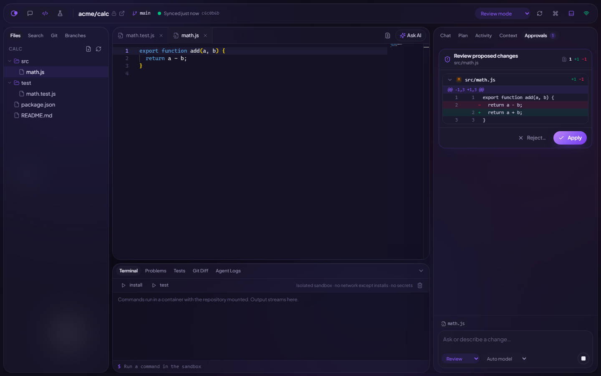
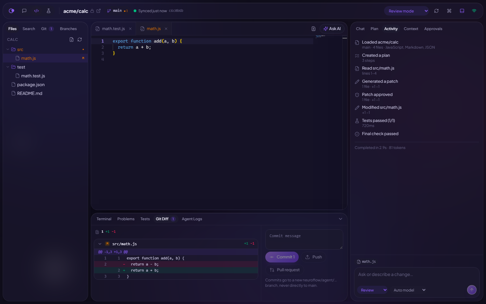
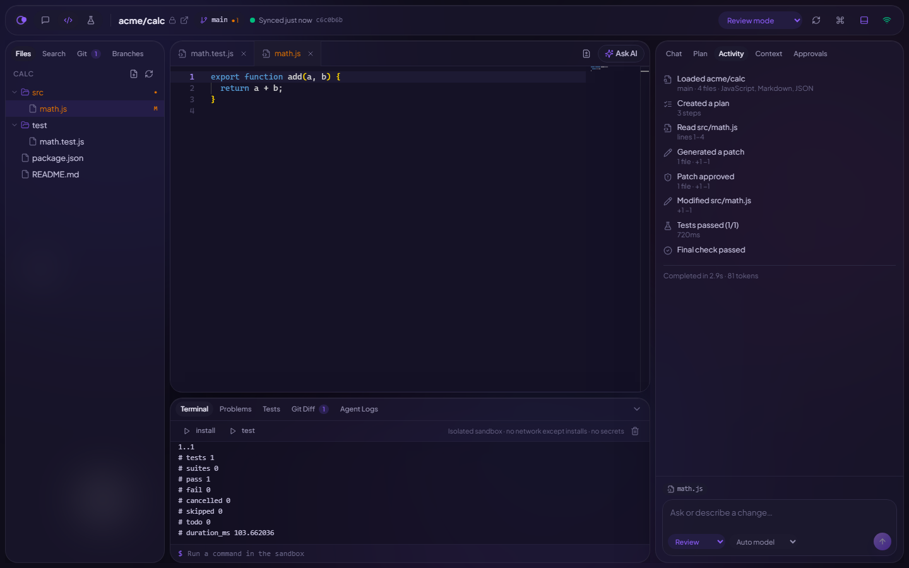
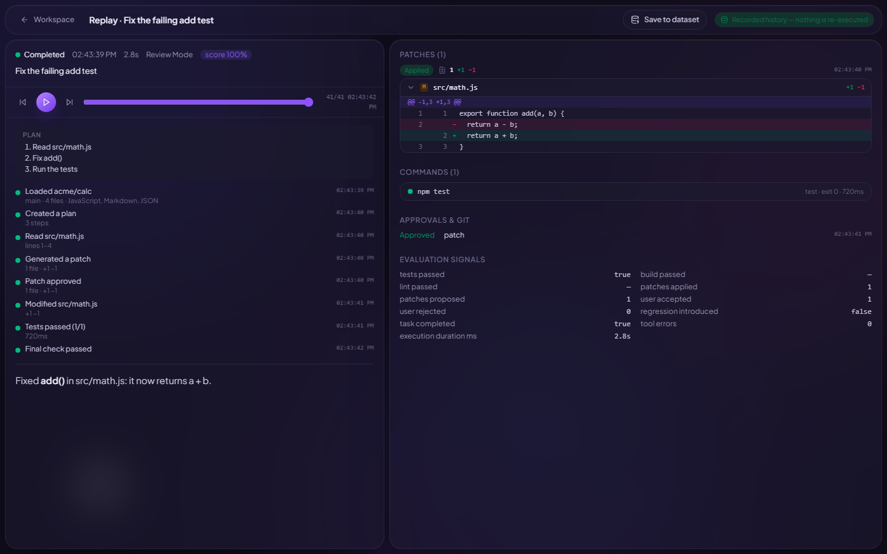
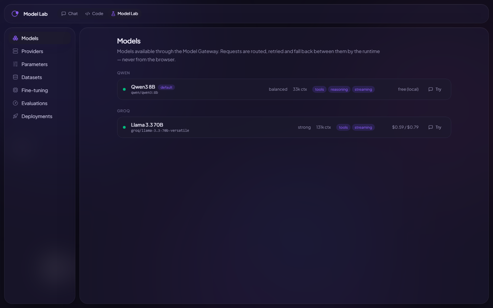

<div align="center">

# NeuroFlow

**An AI workspace with a Code Agent that plans, edits, tests and ships — with you approving every change that matters.**

[](https://github.com/tejasvasingh2004/Tejasva_BCI_Cognitive-state-aware-multi-agent-system/actions/workflows/ci.yml)
[](LICENSE)


[Features](#features) · [Architecture](#architecture) · [Quick start](#quick-start) · [Documentation](#documentation) · [Contributing](#contributing)



</div>

---

NeuroFlow is a production-oriented AI runtime with two product surfaces on **one** backend:

- **AI Workspace** — chat, research and analysis with routed agents, multiple models, tools, memory,
  evaluation and live execution events.
- **Code Workspace** — an AI IDE: connect GitHub, pick a repository and branch, browse and edit in
  Monaco, and ask the Code Agent for a change. It plans, shows every edit as a diff, runs your tests
  in an isolated sandbox, repairs failures, then commits on its own branch and opens a draft pull
  request.

An optional **Cognitive Mode** adapts how work is presented to the user's current workload, using a
manual setting or an EEG workload classifier (research origin of the project).

## Features

| | |
| --- | --- |
| **Adaptive runtime** | Six execution strategies (direct → supervisor / evaluator-optimizer); the router picks the smallest reliable one and chooses agents and models independently |
| **Model Gateway** | Provider-independent streaming, reasoning budgets, timeouts, retries, fallbacks, shared rate budgets and a circuit breaker per provider — Groq and Qwen today |
| **Safe tool runtime** | Every tool call is schema-validated, authorized and, when consequential, approved by the user; 27 Code Agent tools for repositories, editing, execution, Git and GitHub |
| **Plan Review** | Approve, edit or revise the agent's plan before it touches the repository |
| **Reviewable changes** | Suggest / Review / Auto / Restricted modes; patches are validated before they are shown; deletes and large changes always ask |
| **Sandboxed execution** | Commands run in throwaway Docker containers: no network by default, read-only system, no secrets, CPU / memory / time limits |
| **Safe Git workflow** | Commits only on `neuroflow/agent/*` branches, pushes need authorization, pull requests open as drafts, nothing is ever merged |
| **Replay** | Every run is recorded; replay reads stored history and never re-executes |
| **Model Lab** | Models, providers, parameters, datasets, evaluations and deployments — fine-tuning support stated honestly per provider |
| **Built to scale** | Stateless API, fair per-tenant queues, plan-based rate limits and quotas, OpenTelemetry tracing |
| **OpenAI-compatible API** | `POST /v1/chat/completions` maps onto the same runtime |

<table>
  <tr>
    <td></td>
    <td></td>
  </tr>
  <tr>
    <td></td>
    <td></td>
  </tr>
</table>

## Architecture

```text
React (apps/web) ──HTTP/SSE──► Fastify API (apps/api)
                                 │ auth · plan rate limits · admission · Run Manager
                                 ▼
                     Redis + BullMQ  (runs | workspace | evals queues)
                                 ▼
                     Worker (apps/worker) ── per-tenant fairness
                                 ▼
                     Orchestrator ─► Context Engine ─► Router ─► Agent Runtime
                                 │                                  │
                                 ├─► Model Gateway ─► Groq / Qwen   │
                                 ├─► Tool Runtime ─► Docker sandbox, Git, GitHub
                                 └─► Evaluation
                                 ▼
                     Realtime events ──► React (live progress, streaming, inspector)

PostgreSQL: runs, events, artifacts, approvals, memory, workspaces, audit
```

Phase 2 (the Code Workspace) is a specialization of the Phase 1 runtime — the same runs, agents,
models, tools, events and persistence — not a second backend. Details:
[architecture](docs/architecture.md) · [system design](docs/system-design.md) ·
[decisions](docs/decisions.md).

### Tech stack

| Layer | Technology |
| --- | --- |
| Frontend | React 19, TypeScript, Vite 7, Tailwind CSS 4, TanStack Query, Zustand, Monaco |
| Backend | Node.js 22, Fastify 5, Zod 4, BullMQ |
| Data | PostgreSQL, Redis |
| AI | Groq (GPT-OSS 120B / 20B, Qwen3 32B), Qwen via Ollama, OpenAI-compatible providers |
| Infrastructure | Docker, OpenTelemetry, GitHub Actions, Vercel, Railway |
| Research | Python, MNE, scikit-learn, LightGBM, XGBoost, FastAPI (EEG workload classifier and sidecar) |

## Repository layout

```text
apps/
  api/          Fastify API: auth, rate limits, Run Manager, routes
  worker/       BullMQ workers: runs, repository jobs, evaluations
  web/          Product UI: AI Workspace, Code Workspace, Model Lab
  site/         Marketing site (pre-rendered static pages)
packages/
  contracts/    Shared types and schemas
  orchestrator/ Router, execution strategies, agent runtime, context engine
  models/       Model Gateway and provider adapters
  tools/        Tool Runtime and core tools
  code/         Code Agent tools, Git, GitHub, sandbox
  memory/       Memory service
  cognitive/    Cognitive Mode policy
  bus/          Queues, events, rate limiting
  db/           PostgreSQL access, migrations runner, admin CLI
  observability/ OpenTelemetry and logging
infra/          SQL migrations, Dockerfiles, nginx
backend/        Python EEG cognitive-state sidecar (optional)
workload_classifier/  EEG preprocessing, features and classifier training
docs/           Product, architecture, design, status and guides
```

## Quick start

**Requirements:** Node.js 22+, pnpm 9 (`corepack enable`), Docker, and a model provider —
a [Groq API key](https://console.groq.com) or a local [Ollama](https://ollama.com) with a Qwen model.

```bash
git clone https://github.com/tejasvasingh2004/Tejasva_BCI_Cognitive-state-aware-multi-agent-system.git neuroflow
cd neuroflow
cp .env.example .env          # set GROQ_API_KEY or QWEN_BASE_URL
pnpm install
pnpm infra:up                 # PostgreSQL :5433, Redis :6380
pnpm dev                      # API :8080 · worker · web :5173 · site :5180
```

Open <http://localhost:5173>. Migrations run on start; with `AUTH_MODE=dev` a development workspace and user are seeded. Full guide:
[docs/SETUP.md](docs/SETUP.md).

### Tests

```bash
pnpm typecheck && pnpm lint
pnpm test        # unit + integration (real PostgreSQL, Redis, BullMQ, Git and Docker)
pnpm test:e2e    # Playwright end-to-end flows
```

CI runs all of them on every push and pull request.

## Deployment

| Component | Suggested host |
| --- | --- |
| `apps/site`, `apps/web` | Vercel or any static CDN (`vercel.json` included) |
| `apps/api` | Railway (`nixpacks.toml`), a VM, or Docker |
| `apps/worker` + sandbox | A VM with Docker (the sandbox needs a Docker daemon) |
| PostgreSQL, Redis | Neon, Upstash, or self-hosted |

Step-by-step guide: [docs/DEPLOYMENT.md](docs/DEPLOYMENT.md). Self-hosting with Docker Compose:
`docker compose --profile app up -d`.

### Horizontal scaling, measured

[`infra/loadtest/`](infra/loadtest/README.md) runs N API replicas and M workers behind an nginx load
balancer and drives them with k6. Same load (100 reads/s + 10 runs/s for 60 s):

| | 1 API + 1 worker | 2 APIs + 2 workers |
| --- | --- | --- |
| Runs admitted | 86 % (rest refused by admission control) | 100 % |
| Run end-to-end p50 / p95 | 20.5 s / 34.8 s | 2.6 s / 5.6 s |
| API read p95 | 16.6 ms | 10.7 ms |
| Requests per API replica | — | 50.1 % / 49.9 % |

## Documentation

| Document | Contents |
| --- | --- |
| [docs/STATUS.md](docs/STATUS.md) | Current state: what is built, verified, deployed and open |
| [docs/prd.md](docs/prd.md) | Product requirements (authoritative) |
| [docs/architecture.md](docs/architecture.md) | Production architecture for both product phases |
| [docs/system-design.md](docs/system-design.md) | Implementation-level contracts |
| [docs/decisions.md](docs/decisions.md) | Design decisions and trade-offs |
| [docs/progress.md](docs/progress.md) | Requirement-by-requirement progress |
| [docs/ROADMAP.md](docs/ROADMAP.md) | Remaining infrastructure and scaling work |
| [docs/SETUP.md](docs/SETUP.md) · [docs/DEPLOYMENT.md](docs/DEPLOYMENT.md) | Local setup and hosting |
| [CHANGELOG.md](CHANGELOG.md) | Notable changes |

## Contributing

Contributions are welcome. Please read [CONTRIBUTING.md](CONTRIBUTING.md) and the
[Code of Conduct](CODE_OF_CONDUCT.md) first. Report security issues privately as described in
[SECURITY.md](SECURITY.md).

## Acknowledgements

- Dr. Mitul Kumar Ahirwal (Department of CSE, MANIT Bhopal) for academic guidance on the original
  BCI research.
- The authors of the **STEW** EEG workload dataset (Wei Lun Lim, Olga Sourina, Lipo Wang), used by
  the workload classifier. The dataset is subject to its own licence.

## License

[MIT](LICENSE) © Tejasva Singh Chouhan
