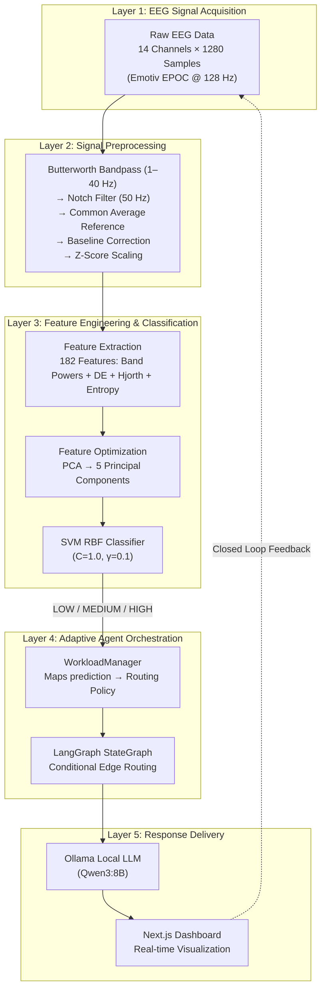
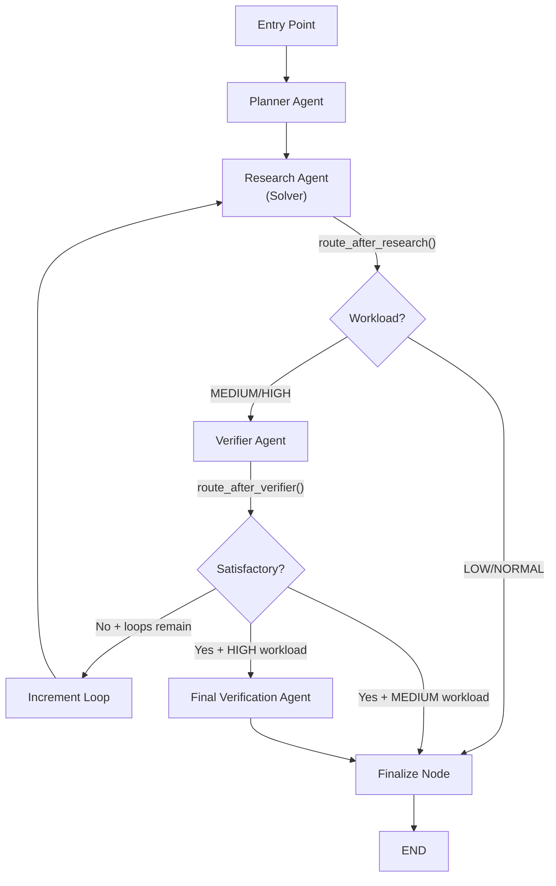
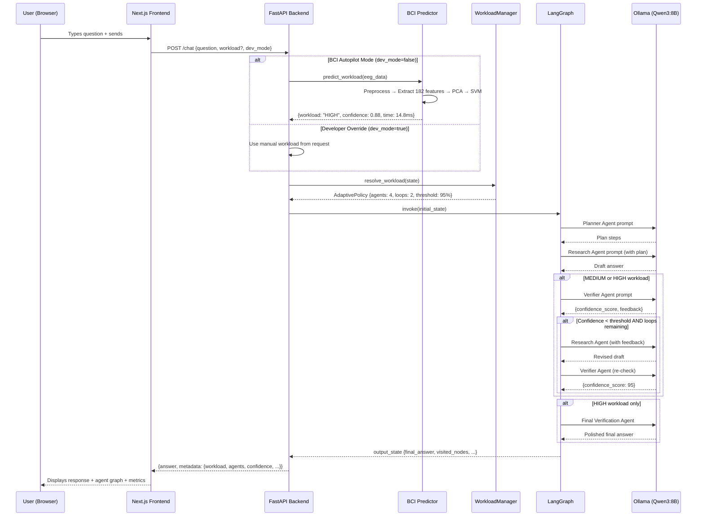

# Cognitive-State-Aware Adaptive Multi-Agent BCI System — Complete Repository Analysis

---

## 1. Project Vision — What Are We Doing & Why?

### 1.1 The Problem

When humans interact with AI chat assistants, their **cognitive workload** fluctuates — sometimes they're relaxed and can absorb detailed explanations, other times they're mentally overloaded and need concise, bullet-point answers. Today's AI assistants are **cognitively blind**: they generate the same verbose response regardless of the user's mental state, leading to information overload and suboptimal human-AI collaboration.

### 1.2 The Solution

This project builds a **closed-loop Brain-Computer Interface (BCI) system** that:
1. **Reads the user's brain activity** in real-time via EEG (electroencephalography)
2. **Classifies their cognitive workload** into one of three levels (LOW, MEDIUM, HIGH)
3. **Dynamically adapts** the downstream AI agent collaboration topology — choosing how many agents verify, refine, and format the response
4. **Delivers cognitively-optimized responses** — verbose when the user can handle detail, compressed bullet points when they're overloaded

### 1.3 Why This Matters

- **Neuroscience-grounded HCI**: Bridges Brain-Computer Interfaces with modern LLM-based AI agents
- **Adaptive collaboration**: Instead of one-size-fits-all, the system adapts its reasoning depth and output format to the user's real-time neurophysiological state
- **Research-grade pipeline**: Uses scientifically validated EEG signal processing, rigorous ML evaluation with cross-subject validation, and transparent agent routing

---

## 2. System Architecture — The Five-Layer Closed Loop

The system follows a **five-layer closed-loop architecture** where each layer feeds into the next:



### Why This Architecture?

| Design Decision | Rationale |
|:---|:---|
| **Closed-loop** | The system continuously monitors the user's state and adapts — not just a one-shot classification |
| **Five discrete layers** | Separation of concerns: signal processing, ML, orchestration, LLM, and UI are independently testable and replaceable |
| **Local inference (Ollama)** | No cloud dependency — all LLM computation stays on the user's machine for privacy and latency |
| **LangGraph for orchestration** | Provides stateful, cyclic graph execution with conditional edges — perfect for variable-depth agent loops |

---

## 3. The Complete Processing Pipeline

### Pipeline Summary

```
Raw EEG (14ch × 1280 samples)
    │
    ├─► [1] Bandpass Filter (1.0–40.0 Hz, 4th-order Butterworth, zero-phase)
    ├─► [2] Notch Filter (50 Hz, Q=30, IIR)
    ├─► [3] Common Average Reference (CAR)
    ├─► [4] Baseline Correction (zero-mean per channel)
    ├─► [5] Z-Score Scaling (unit variance per channel)
    │
    ├─► [6] Welch PSD Estimation (nperseg=256, 0.5 Hz resolution)
    ├─► [7] Absolute Band Powers (Theta 4–8, Alpha 8–12, Beta 12–30 Hz)
    ├─► [8] Relative Band Powers (normalized by total power)
    ├─► [9] Differential Entropy per band
    ├─► [10] Hjorth Parameters (Activity, Mobility, Complexity)
    ├─► [11] Spectral Entropy
    │       = 182 features (13 features × 14 channels)
    │
    ├─► [12] PCA Projection → 5 Principal Components
    ├─► [13] StandardScaler → SVM RBF (C=1.0, γ=0.1, probability=True)
    │       = Binary P(High) probability
    │
    ├─► [14] Thresholding: P(High) < 0.35 → LOW
    │                       0.35 ≤ P(High) ≤ 0.65 → MEDIUM
    │                       P(High) > 0.65 → HIGH
    │
    ├─► [15] WorkloadManager → AdaptivePolicy resolution
    ├─► [16] LangGraph execution (variable-depth agent chain)
    ├─► [17] Ollama Qwen3:8B local inference (per-agent LLM call)
    │
    └─► [18] Final response → Next.js dashboard
```

---

## 4. Layer-by-Layer Deep Dive

### 4.1 Layer 1: EEG Data Acquisition & Dataset

**Dataset**: [STEW (Simultaneous Task EEG Workload)](https://ieee-dataport.org/open-access/stew-simultaneous-task-eeg-workload-dataset)

| Property | Value |
|:---|:---|
| Source | Wei Lun Lim, Olga Sourina, Lipo Wang (2018) |
| Hardware | Emotiv EPOC 14-channel wireless EEG headset |
| Sampling Rate | 128 Hz |
| Channels | 14 (AF3, F7, F3, FC5, T7, P7, O1, O2, P8, T8, FC6, F4, F8, AF4) |
| Total Subjects Recorded | 48 |
| Excluded Subjects | 3 (IDs: 5, 24, 42 — missing subjective ratings) |
| Included Subjects | 45 |
| Recording Duration | 150 seconds (2.5 min) per subject |
| Samples per Epoch | 19,200 (128 Hz × 150 sec) |
| Ground Truth Labels | Subjective workload ratings on 1–9 scale |

**Label Mapping**:

| Rating | Three-Class Label | Binary Label |
|:---|:---|:---|
| 4, 5 | Class 0 — Normal | Class 0 — Normal |
| 6, 7 | Class 1 — Moderate | 6 → Normal, 7 → High |
| 8, 9 | Class 2 — High | Class 1 — High |

> [!NOTE]
> The binary classification scheme follows the original paper's convention: ratings ≤6 are "Normal", ratings ≥7 are "High". The three-class scheme adds a "Moderate" category for ratings 6–7.

**Key Source Files**:
- [data_loader.py](file:///d:/Document/bci/workload_classifier/utils/data_loader.py) — Loads MATLAB `.mat` files, validates dimensions, maps labels
- Data stored at: `workload_classifier/data/stew/dataset.mat`

---

### 4.2 Layer 2: Signal Preprocessing

All preprocessing is implemented in [filter.py](file:///d:/Document/bci/workload_classifier/preprocessing/filter.py) and orchestrated by [pipeline.py](file:///d:/Document/bci/workload_classifier/preprocessing/pipeline.py).

#### Step-by-Step Pipeline:

| Step | Function | Parameters | Scientific Rationale |
|:---|:---|:---|:---|
| **1. Bandpass Filter** | [bandpass_filter](file:///d:/Document/bci/workload_classifier/preprocessing/filter.py#L23-L66) | 1.0–40.0 Hz, 4th-order Butterworth, zero-phase (`filtfilt`) | Removes slow drifts (<1 Hz) and muscle EMG contamination (>40 Hz). Preserves Theta (4–8), Alpha (8–12), and Beta (12–30) bands. Zero-phase via `filtfilt` prevents temporal distortion. |
| **2. Notch Filter** | [notch_filter](file:///d:/Document/bci/workload_classifier/preprocessing/filter.py#L69-L95) | 50 Hz, Q=30, IIR notch | Suppresses Singapore 50 Hz power-line noise. High Q factor ensures narrow rejection bandwidth. |
| **3. CAR** | [common_average_reference](file:///d:/Document/bci/workload_classifier/preprocessing/filter.py#L98-L120) | Subtract channel mean at each time point | Emotiv EPOC's CMS/DRL reference introduces common-mode noise. CAR cancels widespread noise, enhancing focal neural signals. |
| **4. Baseline Correction** | [baseline_correction](file:///d:/Document/bci/workload_classifier/preprocessing/filter.py#L123-L144) | Subtract temporal mean per channel | Centers signals at zero to prevent DC offset from biasing FFT/PSD computation. |
| **5. Z-Score Scaling** | [channel_scaling](file:///d:/Document/bci/workload_classifier/preprocessing/filter.py#L147-L173) | (x − μ) / σ per channel per epoch | Normalizes amplitude variations caused by skull thickness, hair, and electrode contact quality differences. |
| **6. Experimental ICA** | [run_experimental_ica](file:///d:/Document/bci/workload_classifier/preprocessing/ica.py#L13-L105) | FastICA, 12 components, kurtosis + frontal correlation thresholds | Optional artifact removal — decomposes multichannel EEG into independent sources, zeros out blink/ocular artifacts identified by high kurtosis and frontal channel correlation. |

> [!IMPORTANT]
> ICA is **disabled by default** (`apply_ica=False` in [PreprocessingConfig](file:///d:/Document/bci/workload_classifier/preprocessing/pipeline.py#L23-L53)). It's experimental because 14 channels severely constrains ICA's source separation quality.

---

### 4.3 Layer 3: Feature Engineering

Implemented in [extractor.py](file:///d:/Document/bci/workload_classifier/extractor.py).

#### 4.3.1 Segmentation (Training only)

The continuous 150-second recordings are segmented into **10-second sliding windows** with **5-second overlap** via [segment_data](file:///d:/Document/bci/workload_classifier/extractor.py#L30-L105):

| Parameter | Value | Rationale |
|:---|:---|:---|
| Window Length | 10 seconds (1280 samples) | Sufficient for stable PSD estimation |
| Step Size | 5 seconds (50% overlap) | Data augmentation: produces ~1305 total windows |

#### 4.3.2 Feature Extraction — Per Channel (×14 channels)

For each of the 14 EEG channels, 13 features are extracted = **182 total features**:

| Feature Category | Features | Count | Algorithm | Mathematical Foundation |
|:---|:---|:---|:---|:---|
| **Absolute Band Power** | θ (4–8 Hz), α (8–12 Hz), β (12–30 Hz) | 3 | Welch PSD (nperseg=256) + band integration | P_band = Σ PSD(f) · Δf for f ∈ [f_low, f_high] |
| **Relative Band Power** | θ_rel, α_rel, β_rel | 3 | Normalize by total power across θ+α+β | p_rel = P_band / (P_θ + P_α + P_β) |
| **Differential Entropy** | DE_θ, DE_α, DE_β | 3 | Gaussian assumption | DE = ½ · ln(2πe · σ²) where σ² ≈ band power |
| **Hjorth Parameters** | Activity, Mobility, Complexity | 3 | Time-domain variance analysis | Activity = Var(x); Mobility = √(Var(x')/Var(x)); Complexity = Mobility(x')/Mobility(x) |
| **Spectral Entropy** | H_spec | 1 | Normalized Shannon entropy of PSD | H = −Σ p(f) · log₂(p(f)) / log₂(N) |

> [!TIP]
> **Why these specific features?**
> - **Band Powers**: Theta ↑ = memory encoding effort; Alpha ↓ = cortical desynchronization during active cognition; Beta ↑ = active processing
> - **Differential Entropy**: Compresses amplitude logarithmically (Weber-Fechner Law), reducing inter-subject variability
> - **Hjorth Parameters**: Compact time-domain descriptors — Activity = power, Mobility = mean frequency, Complexity = bandwidth
> - **Spectral Entropy**: Measures spectral flatness — high workload desynchronizes Alpha, increasing entropy

#### 4.3.3 Feature Optimization

Implemented in [feature_optimization.py](file:///d:/Document/bci/workload_classifier/analysis/feature_optimization.py).

Four feature selection methods were systematically compared:

| Method | Approach | How it Works |
|:---|:---|:---|
| **No Selection** | Baseline | All 182 features passed directly |
| **ANOVA Top-K** | Filter method | Rank features by F-test statistic, select top K |
| **PCA** | Projection | Project 182 features into K orthogonal principal components |
| **RF Importance** | Embedded method | Train Random Forest, rank features by Gini impurity reduction |
| **RFE** | Wrapper method | Recursively eliminate least important features using LogisticRegression |

**Result**: The optimization study selected **PCA with K=5 components** as the deployment configuration, stored in [selected_features.json](file:///d:/Document/bci/workload_classifier/data/stew/selected_features.json):

```json
{
    "method": "PCA",
    "k_features": 5,
    "selected_names": ["PC_1", "PC_2", "PC_3", "PC_4", "PC_5"],
    "accuracy": 0.4904,
    "macro_f1": 0.4713,
    "inference_time_ms": 0.1248
}
```

> [!WARNING]
> The current PCA-5 configuration achieves only ~49% accuracy and ~47% macro-F1, which is relatively modest. This is likely because 5 principal components cannot capture enough variance from 182 features for reliable workload discrimination. The system compensates by mapping the binary SVM probability through soft thresholds rather than hard class boundaries.

---

### 4.4 Layer 3 (cont.): ML Classifier Training & Evaluation

Implemented in [classifier.py](file:///d:/Document/bci/workload_classifier/classifier.py).

#### 4.4.1 Models Evaluated

Five classifiers were trained and compared under **strict subject-grouped 5-fold cross-validation** (GroupKFold) to prevent data leakage:

| Model | Algorithm | Key Hyperparameters | Why This Model? |
|:---|:---|:---|:---|
| **Logistic Regression** | Linear boundary with L2 regularization | C ∈ {0.1, 1.0} | Linear baseline; handles multi-collinear band powers |
| **SVM (RBF Kernel)** ✅ | Radial Basis Function kernel SVM | C ∈ {1.0, 10.0}, γ ∈ {scale, 0.1} | Non-linear boundary detection; RBF is ideal for workload level transitions that aren't linearly separable |
| **Random Forest** | Ensemble of decision trees | n_estimators=100, max_depth ∈ {10, None} | Robust to outliers; provides feature importance |
| **XGBoost** | Gradient boosted trees with L1/L2 regularization | n_estimators=100, max_depth ∈ {3, 5} | Captures complex time-frequency interactions |
| **LightGBM** | Leaf-wise gradient boosting | n_estimators=100, max_depth ∈ {3, −1} | Fast convergence on tabular features |

#### 4.4.2 Evaluation Protocol

| Aspect | Choice | Rationale |
|:---|:---|:---|
| **CV Strategy** | GroupKFold (5 splits, grouped by subject) | Prevents same subject's epochs appearing in both train and test — critical because EEG is highly subject-specific |
| **Tuning** | GridSearchCV inside GroupKFold | Hyperparameter selection happens without leaking test data |
| **Metrics** | Accuracy, Balanced Accuracy, Precision, Recall, F1 (macro), ROC-AUC (OvR for multi-class) | Balanced metrics account for class imbalance |
| **Model Selection Criterion** | Best out-of-fold F1-score | F1 balances precision/recall, critical for imbalanced workload classes |
| **Final Model** | Retrained on entire dataset with best hyperparameters | Maximizes data utilization for deployment |

#### 4.4.3 Pipeline Architecture (Deployment)

The production model is stored as `best_model_optimized.joblib` — a scikit-learn `Pipeline`:

```
Pipeline([
    ("scaler", StandardScaler),   ← Fitted on training data
    ("pca", PCA(n_components=5)), ← Projects 182 → 5 features
    ("classifier", SVC(kernel="rbf", C=1.0, γ=0.1, probability=True))
])
```

#### 4.4.4 Binary-to-Ternary Probability Mapping

Since the deployed model is a **binary classifier** (Normal vs. High), the system maps the continuous probability `P(High)` into three discrete workload levels using soft thresholds in [predictor.py](file:///d:/Document/bci/backend/app/core/predictor.py#L186-L202):

```
P(High) < 0.35  →  LOW    (Confidence = 1.0 − P_high)
0.35 ≤ P(High) ≤ 0.65  →  MEDIUM  (Confidence = 1.0 − 2·|P_high − 0.5|)
P(High) > 0.65  →  HIGH   (Confidence = P_high)
```

> [!NOTE]
> This creates a "transition zone" between 0.35 and 0.65 that gracefully handles boundary ambiguity rather than forcing a hard binary decision.

---

### 4.5 Layer 4: Adaptive Agent Orchestration

#### 4.5.1 Workload Policies

Defined in [workload.py](file:///d:/Document/bci/backend/app/core/workload.py):

| Workload | Active Agents | Verification Loops | Confidence Threshold | Detail Level |
|:---|:---|:---|:---|:---|
| **LOW** | Planner → Solver | 0 (bypassed) | 70% | Verbose detailed explanation |
| **MEDIUM** | Planner → Solver → Verifier | 1 | 80% | Balanced explanation |
| **HIGH** | Planner → Solver → Verifier → Final Verifier | 2 | 95% | Bullet points only |

**Design Rationale**: When the user is under HIGH cognitive workload, the system applies *more* verification (to ensure accuracy since the user can't easily spot errors) but *less* verbosity (to reduce information overload). Conversely, under LOW workload, the user can absorb detail and catch errors themselves, so verification is bypassed.

#### 4.5.2 Agent Definitions

All agent implementations are in [agents.py](file:///d:/Document/bci/backend/app/core/agents.py):

| Agent | Role | LLM Temperature | Key Behavior |
|:---|:---|:---|:---|
| **Planner Agent** | Breaks down the user's question into structured sub-steps | 0.2 (default) | Outputs a numbered plan; graceful fallback on error |
| **Research Agent (Solver)** | Generates a comprehensive draft answer following the plan | 0.2 (default) | Adapts writing style to `detail_level` policy; incorporates feedback from Verifier if in a loop |
| **Verifier Agent** | QA auditor — checks accuracy, assigns confidence score | 0.0 (strict) | Outputs JSON: `{confidence_score, is_correct, feedback}`; triggers correction loop if below threshold |
| **Final Verification Agent** | Final safety/coherence audit | 0.0 (strict) | Rigorous sanity check for factual correctness, logical coherence, formatting |
| **Summarizer Agent** | Compresses to action items (legacy, not in active use) | 0.2 (default) | Retained for backward compatibility |

#### 4.5.3 LangGraph State Graph

The graph is built in [agent_flow.py](file:///d:/Document/bci/backend/app/core/agent_flow.py):



**Key routing functions**:
- [route_after_research](file:///d:/Document/bci/backend/app/core/agent_flow.py#L27-L44) — Skips verification for LOW, routes to Verifier for MEDIUM/HIGH
- [route_after_verifier](file:///d:/Document/bci/backend/app/core/agent_flow.py#L46-L81) — Loops back to Solver if quality insufficient, or routes to Final Verification for HIGH

**State Schema** ([AgentState TypedDict](file:///d:/Document/bci/backend/app/core/agents.py#L16-L26)):

```python
class AgentState(TypedDict):
    question: str             # User's original question
    workload: str             # Resolved workload level
    policy: Dict[str, Any]    # Adaptive routing policy parameters
    plan: Optional[str]       # Planner's structured decomposition
    draft_answer: Optional[str]  # Current draft from Research Agent
    feedback: Optional[str]   # Verifier's correction feedback
    confidence_score: int     # Verifier's confidence assessment (0-100)
    final_answer: Optional[str]  # Final polished response
    loop_count: int           # Number of verification iterations completed
    visited_nodes: List[str]  # Ordered sequence of agents that executed
```

---

### 4.6 Layer 4 (cont.): LLM Infrastructure

Implemented in [llm.py](file:///d:/Document/bci/backend/app/core/llm.py):

| Component | Choice | Rationale |
|:---|:---|:---|
| **LLM Provider** | Ollama (local) | Privacy — no data leaves the machine; no API costs |
| **Model** | Qwen3:8B | Good balance of reasoning capability and local inference speed |
| **Interface** | `langchain-ollama` (`ChatOllama`) | Seamless integration with LangGraph's message protocol |
| **GPU Offloading** | Configurable via `OLLAMA_NUM_GPU` | -1 = auto; 0 = CPU only |
| **Instance Management** | Singleton pattern | Single `ChatOllama` instance reused across all agents to prevent memory exhaustion from multiple model loads |
| **Temperature** | 0.2 (generation), 0.0 (verification) | Lower temperature for QA/auditing ensures deterministic, factual assessments |

---

### 4.7 Layer 5: FastAPI Backend

Main application in [main.py](file:///d:/Document/bci/backend/app/main.py).

#### REST API Endpoints:

| Endpoint | Method | Purpose | Key Behavior |
|:---|:---|:---|:---|
| `/health` | GET | System health check | Reports classifier, Ollama, and LangGraph status |
| `/predict-workload` | POST | Standalone BCI prediction | Accepts raw EEG or simulates from STEW dataset |
| `/chat` | POST | Full adaptive chat pipeline | Resolves workload → selects policy → executes LangGraph → returns response with metadata |

#### Dual Operating Modes:

| Mode | `dev_mode` | Workload Source | Use Case |
|:---|:---|:---|:---|
| **BCI Autopilot** | `false` | EEG classifier prediction | Production: real-time brain-adaptive responses |
| **Developer Override** | `true` | Manual selection from frontend | Testing: manually force workload levels |

When in Autopilot mode with no raw EEG provided, the system **auto-simulates** a random 10-second EEG segment from the cached STEW dataset.

---

### 4.8 Layer 5 (cont.): Next.js Frontend Dashboard

Built with **Next.js (TypeScript, React 19) + Tailwind CSS**.

#### Component Architecture:

| Component | File | Purpose |
|:---|:---|:---|
| **Home Page** | [page.tsx](file:///d:/Document/bci/frontend/src/app/page.tsx) | Main orchestrator — manages state, API calls, layout grid |
| **ChatInterface** | [ChatInterface.tsx](file:///d:/Document/bci/frontend/src/components/ChatInterface.tsx) | Chat message display + input; shows workload-tagged messages |
| **WorkloadSelector** | [WorkloadSelector.tsx](file:///d:/Document/bci/frontend/src/components/WorkloadSelector.tsx) | Dev mode toggle + workload state picker (NORMAL/MODERATE/HIGH) |
| **AgentVisualizer** | [AgentVisualizer.tsx](file:///d:/Document/bci/frontend/src/components/AgentVisualizer.tsx) | Visual execution path graph — shows which agents activated |
| **SystemMetrics** | [SystemMetrics.tsx](file:///d:/Document/bci/frontend/src/components/SystemMetrics.tsx) | Real-time metrics: latency, confidence scores, prediction times |
| **Type Definitions** | [types/index.ts](file:///d:/Document/bci/frontend/src/types/index.ts) | TypeScript interfaces for `Message`, `ChatMetadata`, `WorkloadPolicy` |

#### Frontend–Backend State Mapping:

The frontend uses legacy state names while the backend uses standardized names:

| Frontend | Backend | Mapping |
|:---|:---|:---|
| `NORMAL` | `LOW` | Both ways |
| `MODERATE` | `MEDIUM` | Both ways |
| `HIGH` | `HIGH` | Direct |

---

## 5. Complete Repository File Map

```
d:\Document\bci\
│
├── backend/                          # FastAPI Backend Server
│   ├── app/
│   │   ├── __init__.py
│   │   ├── config.py                 # Pydantic Settings (env vars, CORS)
│   │   ├── main.py                   # FastAPI app, REST endpoints
│   │   ├── schemas.py                # Pydantic request/response schemas
│   │   └── core/
│   │       ├── __init__.py
│   │       ├── agent_flow.py         # LangGraph StateGraph + conditional routing
│   │       ├── agents.py             # Agent node functions (Planner, Solver, Verifier, etc.)
│   │       ├── llm.py                # ChatOllama singleton + health check
│   │       ├── predictor.py          # BCI inference pipeline (preprocessing → features → classify)
│   │       └── workload.py           # WorkloadState enum + AdaptivePolicy definitions
│   ├── tests/
│   │   ├── test_flow.py              # Unit tests for routing policies & LangGraph execution paths
│   │   ├── test_bci_integration.py   # Integration tests for all REST endpoints
│   │   └── test_integration_ollama.py # Live Ollama connectivity tests
│   ├── Dockerfile
│   └── requirements.txt
│
├── frontend/                         # Next.js Dashboard
│   ├── src/
│   │   ├── app/
│   │   │   ├── page.tsx              # Main page orchestrator
│   │   │   ├── layout.tsx            # Root layout
│   │   │   └── globals.css           # Global styles
│   │   ├── components/
│   │   │   ├── ChatInterface.tsx     # Chat UI
│   │   │   ├── WorkloadSelector.tsx  # Workload state picker
│   │   │   ├── AgentVisualizer.tsx   # Agent execution path visualization
│   │   │   └── SystemMetrics.tsx     # Real-time performance metrics
│   │   └── types/
│   │       └── index.ts              # TypeScript type definitions
│   ├── package.json
│   ├── tsconfig.json
│   └── Dockerfile
│
├── workload_classifier/              # EEG ML Pipeline
│   ├── classifier.py                 # Model training, tuning, CV evaluation (5 models)
│   ├── extractor.py                  # Feature extraction (182 features per window)
│   ├── preprocessing/
│   │   ├── filter.py                 # Bandpass, Notch, CAR, Baseline, Scaling
│   │   ├── ica.py                    # Experimental FastICA artifact removal
│   │   ├── pipeline.py              # Preprocessing pipeline coordinator
│   │   └── visualize.py              # Signal visualization utilities
│   ├── analysis/
│   │   ├── explore_dataset.py        # Dataset exploration and statistics
│   │   ├── feature_analysis.py       # ANOVA F-tests, boxplots, correlation matrices
│   │   ├── feature_optimization.py   # PCA/ANOVA/RFE/RF optimization study
│   │   ├── plot_evaluation.py        # ML evaluation plots (confusion matrices, ROC curves)
│   │   ├── run_preprocessing.py      # Execute and save preprocessed dataset
│   │   ├── verify_preprocessing.py   # Verify preprocessing quality
│   │   └── inspect_mat.py            # MATLAB file inspector
│   ├── utils/
│   │   └── data_loader.py            # STEW dataset loader (MATLAB → NumPy)
│   ├── data/stew/                    # Serialized models, features, and raw data
│   │   ├── dataset.mat               # Raw STEW EEG recordings (34.8 MB)
│   │   ├── clean_dataset.npy         # Preprocessed EEG tensor (96.7 MB)
│   │   ├── X_feats.npy              # Extracted feature matrix
│   │   ├── best_model_optimized.joblib # Production classifier pipeline
│   │   ├── best_model_binary.joblib   # Best binary model (full features)
│   │   ├── best_model_3class.joblib   # Best 3-class model (full features)
│   │   ├── selected_features.json     # Feature optimization manifest
│   │   ├── evaluation_metrics.json    # Complete CV evaluation logs
│   │   └── optimization_results.json  # Feature optimization study results
│   └── requirements.txt
│
├── reports/                          # Academic reports
├── docker-compose.yml                # Container orchestration
├── .env / .env.example               # Environment configuration
├── README.md                         # Project documentation
└── SETUP.md                          # Installation guide
```

---

## 6. Technology Stack Summary

| Layer | Technology | Version | Purpose |
|:---|:---|:---|:---|
| **Frontend** | Next.js + React 19 + TypeScript | 16.2.9 | Interactive dashboard |
| **Styling** | Tailwind CSS | — | Utility-first CSS framework |
| **Backend API** | FastAPI | ≥0.110.0 | REST API server |
| **Agent Orchestration** | LangGraph | ≥0.030 | Stateful cyclic graph execution |
| **LLM Integration** | langchain-ollama + langchain-core | ≥0.1.0 / ≥0.1.30 | LLM abstraction layer |
| **Local LLM** | Ollama (Qwen3:8B) | — | Local inference, no cloud |
| **ML Framework** | scikit-learn | ≥1.2.0 | SVM, PCA, Pipeline, CV |
| **Boosting Models** | XGBoost, LightGBM | ≥1.7.0 / ≥3.3.5 | Evaluated during training |
| **Signal Processing** | SciPy | ≥1.10.0 | Butterworth filters, Welch PSD, IIR notch |
| **EEG Toolbox** | MNE-Python | ≥1.4.0 | EEG analysis (used in analysis scripts) |
| **Data Formats** | NumPy, SciPy.io (MATLAB) | — | Array processing, .mat file loading |
| **Containerization** | Docker + Docker Compose | — | Multi-service deployment |
| **Data Validation** | Pydantic + pydantic-settings | ≥2.6.0 | Request/response schema validation |
| **HTTP Client** | httpx | ≥0.27.0 | Ollama health check |

---

## 7. Testing Strategy

| Test Suite | File | Coverage |
|:---|:---|:---|
| **Routing Policy Unit Tests** | [test_flow.py](file:///d:/Document/bci/backend/tests/test_flow.py) | Verifies WorkloadManager policy mapping, LOW/MEDIUM/HIGH graph execution paths, verification looping behavior |
| **REST API Integration Tests** | [test_bci_integration.py](file:///d:/Document/bci/backend/tests/test_bci_integration.py) | Tests `/health`, `/predict-workload` (raw + simulated), `/chat` under all three workload scenarios + automated BCI mode |
| **Live Ollama Tests** | [test_integration_ollama.py](file:///d:/Document/bci/backend/tests/test_integration_ollama.py) | End-to-end Ollama connectivity tests |

Tests use `unittest.mock` to isolate LLM calls and verify graph traversal without requiring a live Ollama instance.

---

## 8. Data Flow Diagram — End-to-End Request



---

## 9. Key Design Decisions & Trade-offs

| Decision | Choice | Alternative | Why This Choice |
|:---|:---|:---|:---|
| **Local LLM vs Cloud API** | Ollama (local) | OpenAI/Anthropic API | Privacy, zero cost, latency control, offline capability |
| **Binary SVM → Ternary mapping** | Soft probability thresholds | Train 3-class directly | Binary gives higher confidence; ternary split via probability is smoother |
| **PCA vs ANOVA feature selection** | PCA (5 components) | ANOVA Top-K features | PCA handles correlated features without feature-name dependency |
| **GroupKFold CV** | Grouped by subject | Random KFold | Prevents optimistic leakage — EEG is highly subject-specific |
| **LangGraph vs simple chain** | LangGraph StateGraph | Sequential chain | Supports cyclic verification loops + conditional routing |
| **Singleton LLM instance** | One `ChatOllama` reused | New instance per call | Prevents memory exhaustion from loading 8B model multiple times |
| **EEG simulation fallback** | Random STEW segment | Require hardware | Enables development and testing without physical EEG headset |

---

## 10. Known Limitations & Future Scope

| Limitation | Current State | Future Work |
|:---|:---|:---|
| **No real EEG streaming** | Simulated from cached STEW dataset | Integrate Lab Streaming Layer (LSL) for live Emotiv EPOC data |
| **Modest classifier accuracy** | ~49% with PCA-5 | Tune feature selection (larger K), try deep learning approaches |
| **Single modality** | EEG only | Multimodal fusion with eye-tracking (pupil dilation) and HRV |
| **Static agent prompts** | Hardcoded system prompts | Learn optimal prompts via RLHF or meta-learning |
| **No persistent memory** | Stateless per-request | Add conversation memory and workload trend tracking |

---

> [!IMPORTANT]
> **TL;DR**: This system reads your brain waves, figures out how stressed you are, and dynamically adjusts how many AI agents verify and format a response — giving you detailed explanations when you're relaxed, and crisp bullet points when you're overloaded. It's a full-stack closed-loop BCI system spanning signal processing, machine learning, multi-agent orchestration, local LLM inference, and real-time dashboard visualization.
